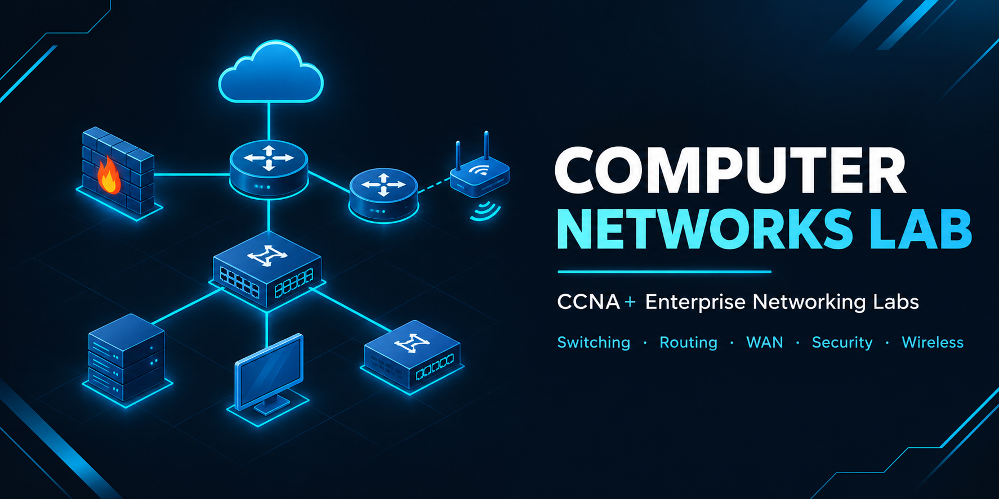

<p align="center">
  
</p>

<h1 align="center">Computer Networks Lab</h1>

<h3 align="center">CCNA+ Enterprise Networking — Switching, Routing, WAN, Security &amp; Wireless</h3>

<p align="center">
  
  
  
  
</p>

<p align="center">
  <a href="#flagship-project"><b>Flagship</b></a> ·
  <a href="#enterprise-projects"><b>Projects</b></a> ·
  <a href="#lab-modules"><b>Lab Modules</b></a> ·
  <a href="#technologies"><b>Technologies</b></a> ·
  <a href="#repository-structure"><b>Structure</b></a> ·
  <a href="#contact"><b>Contact</b></a>
</p>

---

## Overview

A hands-on networking portfolio built with **Cisco Packet Tracer** and Cisco IOS. It covers the full CCNA scope and goes well beyond it — **BGP, EIGRP, GRE, IPSec VPN, AAA (RADIUS/TACACS+), Zone-Based Firewall, VoIP and wireless controllers** — and applies everything in six enterprise-scale network designs.

Every lab module has its own README with the scenario, topology, device configurations, verification commands and result screenshots.

**Reviewing this portfolio?** Start with the [flagship project](#flagship-project).
**Learning networking?** Start with [Module 01](./01-Servers/README.md) and follow the order.

> All labs run in simulated topologies. IP addresses, domains and credentials shown are lab-only values.

## Flagship Project

### PESI — Pakistan Emergency Smart Infrastructure

<p align="center">
  <a href="./Projects/05-PESI-README.md">
    
  </a>
</p>

A national emergency network connecting five sites — Emergency Response Center, Headquarters, two branch offices and a central distribution point.

| | |
| --- | --- |
| **Scale** | 21 servers · 27+ VLANs · 14+ IP phones · 3,200+ user capacity |
| **Routing** | OSPF multi-area (Areas 0, 1, 3) |
| **Edge & Security** | Dual Cisco ASA firewalls · DMZ with public servers · site-to-site IPSec VPN |
| **Connectivity** | Dual ISP (PTCL + Nayatel) · NAT/PAT |
| **Resilience** | HSRP + LACP across sites |
| **Services** | VoIP on every site · wireless via WLC · IoT security system |

[**Read the full documentation →**](./Projects/05-PESI-README.md)

## Enterprise Projects

| #  | Project | Focus | Core Tech |
| -- | ------- | ----- | --------- |
| 01 | [Mini Branch Network](./Projects/01-MINI-BRANCH-README.md) | Small branch office with five departments | `PAT` `HSRP` `OSPF` |
| 02 | [Smart School Automation](./Projects/02-SCHOOL-AUTOMATION-README.md) | IoT-controlled bells, fans and motion sensing | `MCU` `IoT` |
| 03 | [Head Quarter Network](./Projects/03-HQ-NETWORK-README.md) | HQ with six servers, VoIP and wireless | `LACP` `HSRP` `WLC` `VoIP` |
| 04 | [HQ V2 — Security Enhanced](./Projects/04-HQ-V2-SECURITY-README.md) | Centralized authentication and secure management | `AAA` `RADIUS` `SSH` |
| 05 | [PESI Infrastructure](./Projects/05-PESI-README.md) | Multi-site emergency network *(flagship)* | `OSPF` `IPSec` `ASA` `HSRP` |
| 06 | [HQ & Branch with DMZ](./Projects/06-HQ-BRANCH-DMZ-README.md) | HQ–branch design with DMZ *(in progress)* | `DMZ` `ASA` `VPN` |

All topologies and details: [Projects portfolio](./Projects/README.md)

## Lab Modules

| #  | Module | Domain | Focus | Core Tech |
| -- | ------ | ------ | ----- | --------- |
| 01 | [Servers](./01-Servers/README.md) | Services | DNS, DHCP, HTTP, FTP, Email, Syslog, NTP, AAA | `DNS` `DHCP` `FTP` `NTP` `RADIUS` |
| 02 | [Subnetting](./02-Subnetting/README.md) | Addressing | Fixed and variable length subnetting, IP planning | `FLSM` `VLSM` |
| 03 | [VLAN](./03-VLAN/README.md) | Switching | Switch-to-switch links, inter-VLAN routing | `VLAN` `Router-on-a-Stick` `L3 Switch` |
| 04 | [STP](./04-STP/README.md) | Switching | Loop prevention, root bridge election, port roles | `STP` |
| 05 | [EtherChannel](./05-EtherChannel/README.md) | Switching | Link aggregation and load balancing | `LACP` `PAgP` |
| 06 | [Home Router](./06-Home-Router/README.md) | SOHO | Home router setup, NAT, wireless, basic security | `NAT` `Wi-Fi` |
| 07 | [Port Security](./07-Port-Security/README.md) | Layer 2 Security | MAC limiting, violation modes, sticky MAC | `Port Security` |
| 08 | [VLAN Security](./08-VLAN-Security/README.md) | Layer 2 Security | VLAN hopping, double tagging, switch spoofing | `VLAN Hopping` `CDP` |
| 09 | [DHCP Snooping](./09-DHCP-Snooping/README.md) | Layer 2 Security | Rogue DHCP prevention, trusted ports, rate limiting | `DHCP Snooping` |
| 10 | [Link State & Distance Vector](./10-Link-State-Distance-Vector/README.md) | Routing | Protocol categories, comparison, convergence | `Link State` `Distance Vector` |
| 11 | [Dijkstra & Bellman-Ford](./11-Dijkstra-Bellman-Ford/README.md) | Routing | Shortest-path algorithms behind OSPF and RIP | `Dijkstra` `Bellman-Ford` |
| 12 | [Routing Protocols](./12-Routing-Protocols/README.md) | Routing | Static, dynamic and internet-scale routing | `Static` `RIP` `EIGRP` `OSPF` `BGP` |
| 13 | [NAT / PAT](./13-NAT-PAT/README.md) | WAN | Static NAT, dynamic NAT, PAT overload | `NAT` `PAT` |
| 14 | [PPP](./14-PPP/README.md) | WAN | Serial links and authentication | `PPP` `PAP` `CHAP` |
| 15 | [GRE Tunneling](./15-GRE-Tunneling/README.md) | WAN | Tunnel interfaces, routing over tunnels | `GRE` |
| 16 | [VPN (IPSec)](./16-VPN-IPSec/README.md) | WAN & VPN | Site-to-site VPN, encryption, authentication | `IPSec` |
| 17 | [WLAN](./17-WLAN/README.md) | Wireless | Access points, wireless controller, WPA/WPA2 | `WLC` `WPA2` |
| 18 | [VoIP](./18-VoIP/README.md) | Voice | Call Manager Express, dial plans, voice VLANs | `CME` `Voice VLAN` |
| 19 | [HSRP](./19-HSRP/README.md) | High Availability | First-hop redundancy, priority and preemption | `HSRP` |
| 20 | [Firewall](./20-Firewall/README.md) | Security | Zone-based firewall, policies, traffic filtering | `ZBF` |
| 21 | [ACL](./21-ACL/README.md) | Security | Standard, extended and named ACLs, placement | `ACL` |
| 22 | [SSH & Telnet](./22-SSH-Telnet/README.md) | Security | Secure remote access, VTY line security | `SSH` `Telnet` `VTY` |

## Technologies

| Category | Tools & Protocols |
| -------- | ----------------- |
| **Platform** | `Cisco Packet Tracer` `Cisco IOS` |
| **Switching** | `VLAN` `STP` `EtherChannel` `HSRP` `Port Security` `DHCP Snooping` |
| **Routing** | `Static` `RIP` `EIGRP` `OSPF` `BGP` |
| **WAN & VPN** | `NAT/PAT` `PPP` `GRE` `IPSec` |
| **Security** | `ACL` `Zone-Based Firewall` `Cisco ASA` `AAA` `SSH` |
| **Wireless & Voice** | `WLC` `Access Points` `WPA2` `Call Manager Express` |
| **Services** | `DNS` `DHCP` `HTTP` `FTP` `Email` `Syslog` `NTP` |

## Repository Structure

```
computer-networks-lab/
├── README.md
├── LICENSE
├── images/banner.png
│
├── 01-Servers/ … 22-SSH-Telnet/     # one folder per module
│   ├── README.md                    #   scenario, topology, configs, results
│   └── images/                      #   screenshots
│
└── Projects/
    ├── README.md                    # portfolio overview
    ├── 01-MINI-BRANCH-README.md … 06-HQ-BRANCH-DMZ-README.md
    └── images/                      # topologies
```

## License

**© 2026 Abdul Wahid** — licensed under **[CC BY-NC-ND 4.0](./LICENSE)** (Attribution, NonCommercial, NoDerivatives).
You may view, reference and share a link to this work with credit. Commercial use and redistributing modified copies are not permitted.

## Contact

**Abdul Wahid**

[](mailto:a.wahid7860668@gmail.com)
[](https://www.linkedin.com/in/abdul-wahid022)
[](https://github.com/abdul-wahid022)

If this repository helped you, consider starring it.
